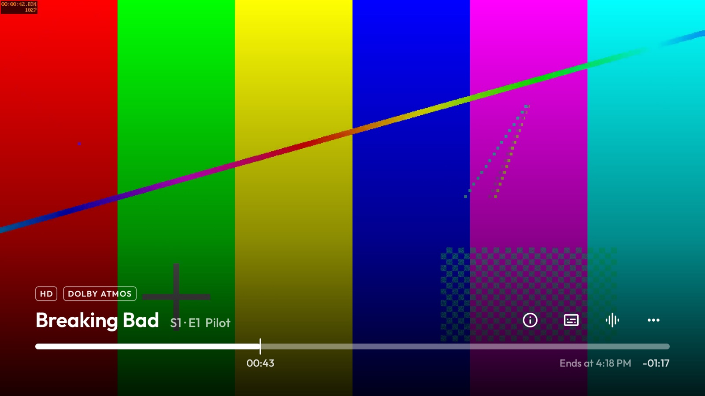
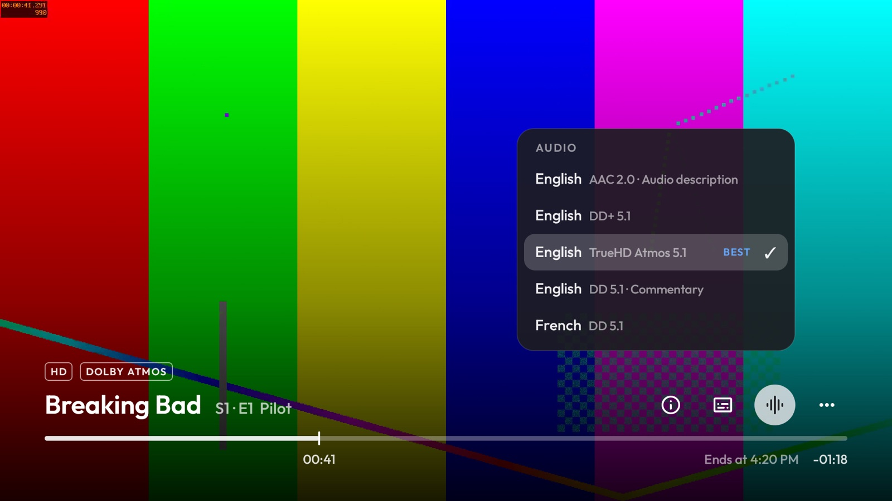
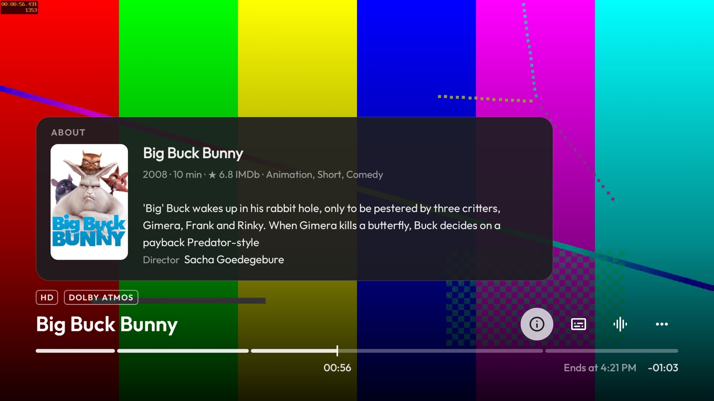
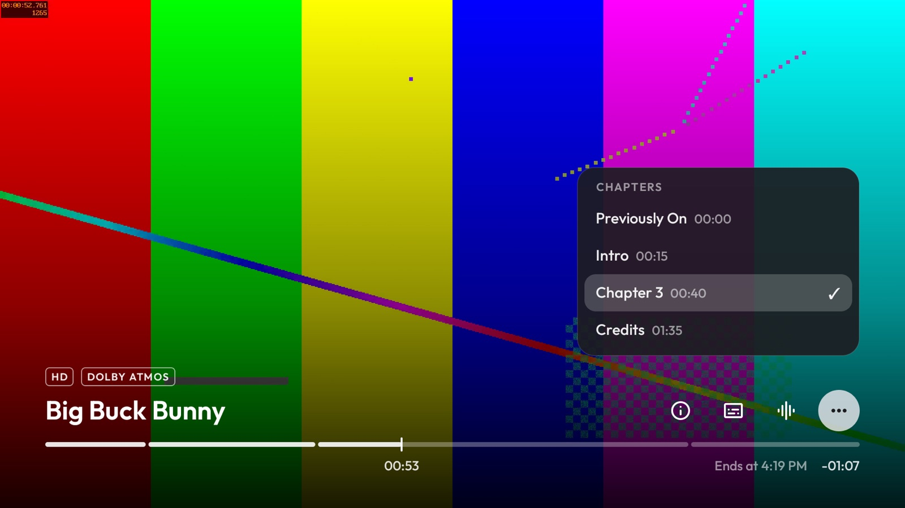
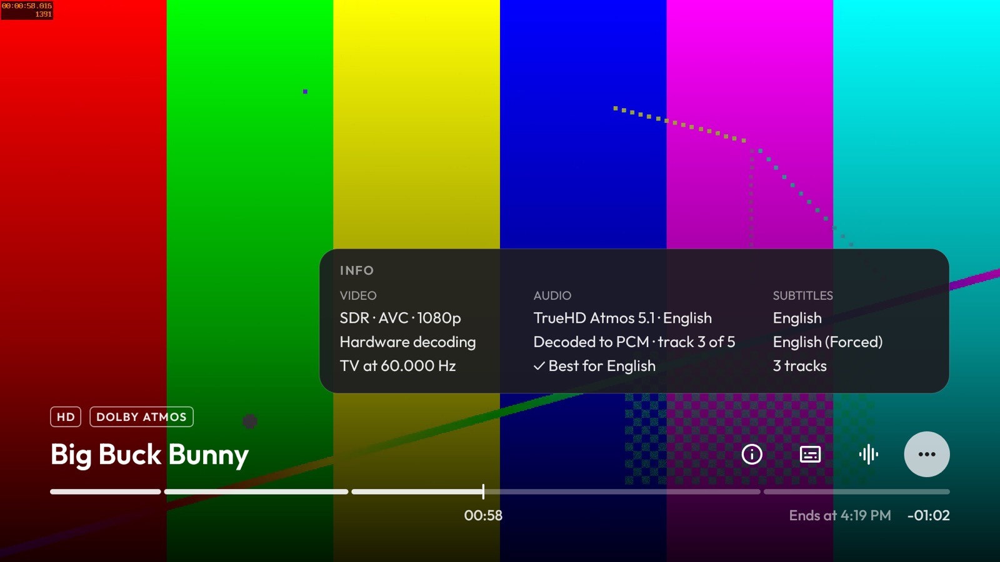

# Enhanced Just Player

A fork of [Just (Video) Player](https://github.com/moneytoo/Player) by [moneytoo](https://github.com/moneytoo), tuned for Android TV boxes such as the NVIDIA SHIELD and for use as [Stremio](https://www.stremio.com)'s external player. It plays the best audio track by itself, knows what it is playing, and has a remote-friendly interface in the style of tvOS. Everything else is Just Player.



 
 

<sub>Screenshots from the Android TV emulator with a test pattern; the About panel shows [Big Buck Bunny](https://peach.blender.org) (CC BY, Blender Foundation).</sub>

## What's different

### Sound and picture

- **The best audio track, automatically.** Players normally start the track a file marks as default, often a stereo or audio description track. Among the tracks in your language this player picks object audio first (Dolby Atmos, DTS:X), then lossless (TrueHD, DTS-HD MA), then the most channels. Commentary and audio description are never picked on their own, and a different language is never "better", only a choice. A track you choose yourself always wins.
- **Dolby Atmos detection.** Matroska says "E-AC3" or "TrueHD" without saying whether it carries Atmos; the player reads the first passthrough frames (E-AC3 JOC, TrueHD's 16-channel substream) the way a receiver does, so Atmos shows up in the badges and menus.
- **One blackout when a film starts and one when it ends.** With frame-rate matching on, the rate is read from the Matroska header with a single small request and the TV switches before playback begins, instead of switching after video and audio have started and making the TV and soundbar resync. On exit the mode request is released before the window closes.

### Knows what it is playing

Stremio hands an external player only a link. For streams from the [Comet](https://github.com/g0ldyy/comet) addon the link names the title, its IMDb id and the episode, and the player uses that:

- **Title and episode** in the controls, e.g. "Breaking Bad  S1 · E1  Pilot".
- **About**: poster, year, runtime, IMDb rating, genres, synopsis, cast and director from [Cinemeta](https://v3-cinemeta.strem.io), Stremio's own metadata service. Only the IMDb id is sent.
- **Remembered choices.** Subtitle and audio choices are remembered per show, and your last subtitle choice applies to anything new, so subtitles stop switching themselves off. Kept on the device only.
- **Skip intro, recap and credits.** From the file's chapters when they are named for it, otherwise from [TheIntroDB](https://theintrodb.org), a crowd-sourced database looked up by IMDb id, season, episode and duration. The online lookup can be turned off in Player settings.

  

### The interface, after tvOS

- One line at the bottom: the title and episode, format badges above it (4K, Dolby Vision · Atmos), and a warning only when a better audio track exists in your language. About, Subtitles, Audio and More sit on the right.
- A thin timeline split at chapter starts, the elapsed time under the playhead, and "Ends at 22:41" with the time left at the end. OK plays and pauses, Left and Right seek.
- Menus open above their button and keep the controls up while open. More holds Info (video, audio, passthrough, display refresh rate and subtitles), Chapters, aspect ratio, picture-in-picture, open file and settings. Back steps out one level at a time; Up from the top row closes the controls.
- The controls stay up for 7 seconds when a video starts, so the title is readable once the TV has switched modes. Dark glass menus that do not glare when the TV is in HDR.

It installs next to Just Player as its own app (`io.github.royalgit.enhancedjustplayer`).

## Using it with Stremio

In Stremio, set Settings → Playback → Default player to **External**, then choose **Enhanced Just Player** and **Always** when Android asks. Stremio keeps your watch progress: the player hands the position back when you exit. In the player, turn on More → Player settings → **Auto frame rate matching** so 24p films play at 24 Hz.

Title, About, remembered choices and skip timestamps need a link that identifies the title, which Comet's do. With other addons the player still works as a plain player.

## Privacy

The player itself sends nothing anywhere except two lookups for streams that identify themselves: the IMDb id to Cinemeta for About, and the IMDb id, season, episode and duration to TheIntroDB for skip timestamps (switchable off). Stream links, which can carry debrid keys, are never logged or sent.

## Building

JDK 17 or newer and the Android SDK (Gradle downloads the platform it needs):

```bash
./gradlew assembleLatestUniversalRelease -PabiFilter=arm64-v8a
apksigner sign --ks <your keystore> --out enhanced-just-player.apk \
    app/build/outputs/apk/latestUniversal/release/Just.Player.v*.apk
adb install enhanced-just-player.apk
```

Leave out `-PabiFilter` for a universal APK.

## Credits and licences

- [Just Player](https://github.com/moneytoo/Player) is released into the public domain ([Unlicense](LICENSE)); the changes in this fork are too.
- [Outfit](https://fonts.google.com/specimen/Outfit) font: SIL Open Font License 1.1, see [FONT-LICENSE-OFL.txt](FONT-LICENSE-OFL.txt).
- Icons: [Material Symbols Rounded](https://github.com/google/material-design-icons), Apache License 2.0.
- Title details from [Cinemeta](https://v3-cinemeta.strem.io); skip timestamps from [TheIntroDB](https://theintrodb.org) contributors.

---

The original Just Player README follows.

# Just (Video) Player 

[](https://github.com/moneytoo/Player/releases/latest)
[](https://play.google.com/store/apps/details?id=com.brouken.player)
[](https://f-droid.org/packages/com.brouken.player/)
[](https://github.com/moneytoo/Player/releases/latest)
[](https://play.google.com/store/apps/details?id=com.brouken.player)
[](https://play.google.com/store/apps/details?id=com.brouken.player)
[](https://github.com/androidx/media/releases/tag/1.11.1)
[](https://hosted.weblate.org/engage/just-player/)
[](https://www.reddit.com/r/JustPlayer/)

Android video player based on [Media3](https://github.com/androidx/media) (formerly [ExoPlayer](https://github.com/google/ExoPlayer)), compatible with Android 6+ and Android TV.

It uses ExoPlayer's ``ffmpeg`` extension with [all its audio formats](https://exoplayer.dev/supported-formats.html#ffmpeg-extension) enabled (it can handle even special formats like AC3, EAC3, DTS, DTS HD, TrueHD etc.).

It properly syncs audio with video track when using Bluetooth earphones/speaker. (I was not able to find any other nice ExoPlayer based video player so I created this one.)

## Supported formats

 * **Audio**: Vorbis, Opus, FLAC, ALAC, PCM/WAVE (μ-law, A-law), MP1, MP2, MP3, AMR (NB, WB), AAC (LC, ELD, HE; xHE on Android 9+), AC-3, E-AC-3, DTS, DTS-HD, TrueHD, IAMF, MPEG-H
 * **Video**: H.263, H.264 AVC (Baseline Profile; Main Profile on Android 6+), H.265 HEVC, MPEG-4 SP, VP8, VP9, AV1
 * **Containers**: MP4, MOV, WebM, MKV, Ogg, MPEG-TS, MPEG-PS, FLV, AVI (🚧)
 * **Streaming**: DASH, HLS, SmoothStreaming, RTSP
 * **Subtitles**: SRT, SSA/ASS ([limited styling](https://github.com/google/ExoPlayer/issues/8435)), TTML, VTT, DVB

HDR (HDR10+ and Dolby Vision) video playback on compatible/supported hardware.

AC-4 audio is supported on devices providing such system decoder (e.g. Samsung Galaxy A, S and Z series running Android 11 or later).

## Screenshots

  

## Features

 * Audio/subtitle track selection
 * Playback speed control
 * Horizontal swipe and double tap to quickly seek
 * Vertical swipe to change brightness (left) / volume (right)
 * Pinch to zoom (Android 7+)
 * PiP (Picture in Picture) on Android 8+ (resizable on Android 11+)
 * Resize (fit/crop)
 * Volume boost
 * Auto frame rate matching on Android TV/boxes
 * Post-playback actions (delete file/skip to next)
 * Touch lock (long tap)
 * App shortcut for direct access to file chooser (Android 7.1+)
 * 3rd party equalizer / audio processing support (e.g. [Wavelet](https://github.com/Pittvandewitt/Wavelet))
 * Media Session and Audio Focus support
 * Pause playback when disconnecting headphones
 * No ads, tracking or excessive permissions

Some advanced features can be enabled or configured in settings. To access it, long press the ⚙️ gear icon. (Alternatively, you can also enter this settings from App info screen.)

 * Default audio tracks. Set specific language, prefer device language, media file defaults.
 * File access mode. Use of Storage Access Framework / MediaStore / legacy file access.
 * Decoder priority. Prefer device or app decoders.
 * Auto frame rate matching. (On Android 11+ and "compatible" displays, ExoPlayer supports [seamless refresh rate switching](https://source.android.com/devices/graphics/multiple-refresh-rate))
 * [Tunneled playback](https://medium.com/google-exoplayer/tunneled-video-playback-in-exoplayer-84f084a8094d). Enabling tunneling can improve playback of 4K/HDR content on Android TV.
 * Playback of Dolby Vision profile 7 (UHD Blu-ray) as HDR HEVC
 * Auto picture-in-picture. When you leave Just Player through the home button and video is playing, PiP will be activated automatically.
 * Skip silence
 * Repeat toggle

**`WRITE_SETTINGS` ("Modify system settings") permission**: When the system file chooser is opened, it will always use current system orientation, even if the Player app sets its own. Granting this permission via adb (`adb shell pm grant com.brouken.player android.permission.WRITE_SETTINGS`) or App info screen will allow this app to temporarily enable Auto-rotate to at least partially mitigate [this imperfection](https://issuetracker.google.com/issues/141968218).

Donate: [PayPal](https://paypal.me/MarcelDopita) | [Bitcoin](https://live.blockcypher.com/btc/address/bc1q9u2ezgsnug995fv0m4vaxa90ujjwlucp78w4n0) | [Litecoin](https://live.blockcypher.com/ltc/address/LLZ3fULGwxbs6W9Vf7gtu1EjZvviCka7zP)

Translate: [Weblate](https://hosted.weblate.org/engage/just-player/)

## Download

[](https://play.google.com/store/apps/details?id=com.brouken.player)
[](https://f-droid.org/packages/com.brouken.player/)
[](https://accrescent.app/app/com.brouken.player)
[](http://apps.obtainium.imranr.dev/redirect.html?r=obtainium://add/https://github.com/moneytoo/Player)
[](https://github.com/moneytoo/Player/releases/latest)
[](https://galaxystore.samsung.com/detail/com.brouken.player)
[](https://appgallery.cloud.huawei.com/ag/n/app/C104147921)
[](https://global.app.mi.com/details?id=com.brouken.player)
[](https://just-player-marcel-dopita.en.aptoide.com/app)
[](https://www.amazon.com/gp/product/B091N8TTJH)

Other links/channels: application thread on [XDA Developers](https://forum.xda-developers.com/t/app-5-0-just-video-player-no-bluetooth-lag-exoplayer-ffmpeg-audio-codecs.4189183/), subreddit on [reddit](https://www.reddit.com/r/JustPlayer/), entry on [AlternativeTo](https://alternativeto.net/software/just-video-player/about/), git mirror on [GitLab](https://gitlab.com/moneytoo/Player)

## ❓FAQ

### How do I open subtitle file (e.g. .srt)?

To load external (non-embedded) subtitles, long press the 📁 file open action in the bottom bar. The first time you do that, you will be offered to select root video folder to enable automatic loading of external subtitles.

💡📺 Because of [limitations on Android TV](https://github.com/moneytoo/Player/issues/248#issuecomment-1019565204), Just Player is also able to open subtitle files from external file managers. You can open video file from your file manager, then return back and also  open subtitle file in Just Player. Subtitle will be available in the last selected video.

Just Player is also able to detect some subtitle files when accessing videos over HTTP/HTTPS. Just use the [same naming](https://github.com/moneytoo/Player/issues/173) for video files as well as subtitles (e.g. `video.mkv` and `video.srt`).

### How do I change subtitle font, size or color?

Open system [Caption preferences](https://support.google.com/accessibility/android/answer/6006554) on your device (usually in the _Accessibility_ section of _Settings_) and you will be able to fully customize the subtitle style.

To quickly access the system _Caption preferences_ screen, long tap the subtitle button.

 

### Are there any media formats it CANNOT play?

Unfortunately, upstream ExoPlayer doesn't handle some older formats like ~~[AVI container](https://github.com/google/ExoPlayer/issues/2092)~~, WMV or [Theora](https://github.com/google/ExoPlayer/issues/4970). Majority of devices also cannot handle [10-bit AVC](https://github.com/moneytoo/Player/issues/87#issuecomment-816228143).

Just Player focuses on playing videos so audio only playback isn't officialy supported ([request](https://github.com/moneytoo/Player/issues/55)).

### How to view detailed video information (like resolution, bitrate etc.)?

Install app like [MediaInfo](https://play.google.com/store/apps/details?id=net.mediaarea.mediainfo) (or APK from [MediaArea.net](https://mediaarea.net/en/MediaInfo/Download/Android)). Then, to quickly open MediaInfo from Just Player, long press the video name/title.

### I prefer using media library instead of a file chooser...

Just Player uses system file chooser which already allows two different browsing modes: 

1. **Videos** - listing only device directories that contain videos

    

2. **File browser** - full navigation in the device file system structure

    

Alternatively, some people choose to use the media library function of
[Nova Video Player](https://github.com/nova-video-player/aos-AVP) and integrate it with Just Player by enabling "*Allow using another video player*" feature. This also gives you convenient access to content on network storages (SMB, UPnP, FTP and SFTP).

### How to access videos on network storages (SMB, WebDAV, SFTP, etc.)?

1. The default system file chooser allows access to any remote storage using appropriate _Document Provider_. I highly recommend [CIFS Documents Provider](https://github.com/wa2c/cifs-documents-provider) for accessing Samba shares. There are also providers like [WebDAV Provider](https://github.com/alexbakker/webdav-provider)/[DAVx⁵](https://github.com/bitfireAT/davx5-ose) (WebDAV), [FileManagerUtils](https://github.com/rikyiso01/FileManagerUtils) (SFTP) and [rcx](https://github.com/x0b/rcx). Sadly, Document providers are not supported on Android TV.

2. Open video directly from your favorite file explorer. _Solid Explorer_ works really well, especially if you also want to automatically load subtitles.

### How do I open a streaming link, where do I enter an url?

Just Player does not have any UI to enter internet addresses, but it is registered for handling all compatible streaming links. When opening/tapping links in other apps, Just Player should be generally offered as an option. (Though this may not work in all situations, especially on Android 12+.)

Alternatively, select the text url in the source app, choose _Share_ and find Just Player to play it.

### How to zoom in to get rid of black bars?

If your device has a touchscreen you can use the pinch-to-zoom gesture or just tap the Resize button for a Crop. **Android TV**: Long tap the Resize button to enter Zoom mode. Then use Up and Down keys for precise zoom.

### What to do if Bluetooth audio is not in sync with video?

Just pause and resume playback once again.

### The orientation switch button doesn't work...

Starting Android 16, apps can't programmatically [switch orientation](https://android-developers.googleblog.com/2025/01/orientation-and-resizability-changes-in-android-16.html). However this functionality can be re-enabled per app. 

Open "Aspect ratio" in system Settings, find Just Player and switch from "Full screen" to "App default".

## Other open source Android video players

Here's a comparison table presenting all available and significant open source video players for Android I was able to find. Just Player is something like ~~80%~~ 90% feature complete. It will probably never have dozens of options or some rich media library UI. It will never truly compete with feature rich VLC. It just attempts to provide functional feature set and motive others to create greater players based on amazing ExoPlayer.

| App name (source)                                                 | Media engine                                                                                                                                                            |
|-------------------------------------------------------------------| ----------------------------------------------------------------------------------------------------------------------------------------------------------------------- |
| [Fermata Media Player](https://github.com/AndreyPavlenko/Fermata) | [MediaPlayer](https://developer.android.com/guide/topics/media/mediaplayer), [ExoPlayer](https://exoplayer.dev/) and [libVLC](https://www.videolan.org/vlc/libvlc.html) |
| [Just (Video) Player](https://github.com/moneytoo/Player)         | [ExoPlayer](https://exoplayer.dev/)                                                                                                                                     |
| [Just Player+](https://github.com/wasky/just-player)              | [ExoPlayer](https://exoplayer.dev/)                                                                                                                                     |
| [Kodi](https://github.com/xbmc/xbmc)                              | ?                                                                                                                                                                       |
| [mpv](https://github.com/mpv-android/mpv-android)                 | [libmpv](https://github.com/mpv-player/mpv)                                                                                                                             |
| [mpvEx](https://github.com/marlboro-advance/mpvEx)                | [libmpv](https://github.com/mpv-player/mpv)                                                                                                                             |
| [Next Player](https://github.com/anilbeesetti/nextplayer)         | [ExoPlayer](https://exoplayer.dev/)                                                                                                                                     |
| [Nova Video Player](https://github.com/nova-video-player/aos-AVP) | MediaPlayer                                                                                                                                                             |
| [Only Player](https://github.com/Kindness-Kismet/only_player)     | [ExoPlayer](https://exoplayer.dev/)                                                                                                                                     |
| [VLC](https://code.videolan.org/videolan/vlc-android)             | [libVLC](https://www.videolan.org/vlc/libvlc.html)                                                                                                                      |

To find other video players (including non-FOSS), check out [a list on IzzyOnDroid](https://android.izzysoft.de/applists/category/named/multimedia_video_player) or my list of [awesome F-Droid apps](https://github.com/moneytoo/awesome-fdroid).
